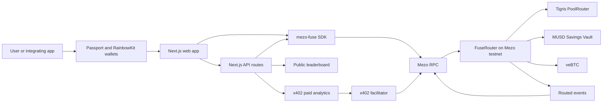
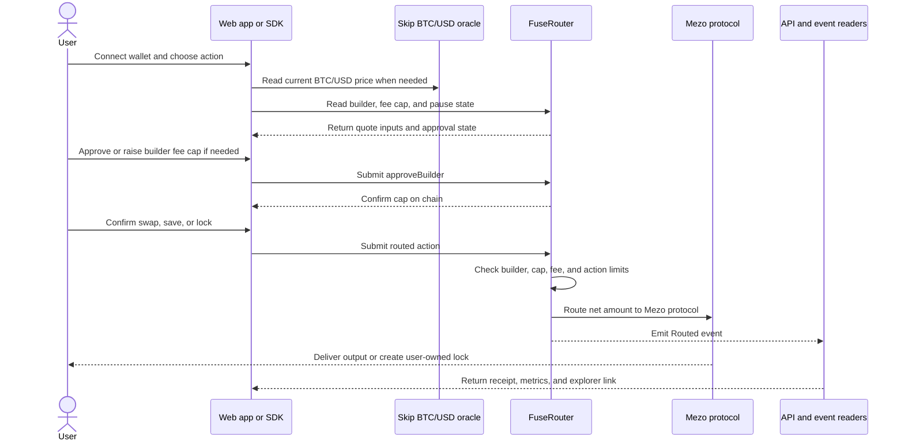

# Fuse

**Earn a fee every time your users swap, save or lock on Mezo, capped by them.**

Fuse is a builder code router for Mezo. A wallet, bot or website sends its users' Mezo actions through `FuseRouter` and gets credit for each one. A builder can charge a fee of up to 0.50%, which the user approves first. Fuse never holds funds and has no token.

The hosted app is live at [fuse.vercel.app](https://fuse.vercel.app/). The current release targets Mezo testnet only, chain ID `31611`.

[Open the app](https://fuse.vercel.app/) · [Try the widget](https://fuse.vercel.app/widget?builder=0xd4b987B2e9F5D1a2ca98A24a8A802eA6068Fc283&action=save) · [Read the docs](https://fuse.vercel.app/docs) · [Install the SDK](https://www.npmjs.com/package/mezo-fuse)

## How it works

1. A builder registers on `FuseRouter` with a fee from 0 to 50 bps and a metadata URI. Anyone can register.
2. Before any registered builder can route for them, a user approves a fee cap for that builder. A zero-fee builder still requires an explicit 0 bps approval.
3. The user swaps on Tigris, saves into the MUSD Savings Vault or locks BTC as veBTC through the router.
4. The router takes the builder fee, sends the rest to Mezo and emits a `Routed` event with the builder, user, amounts and fee.
5. The leaderboard and paid analytics are built from those events.

## What users control

- A builder can't charge more than the cap the user approved. If the builder raises its fee above that cap, the transaction reverts with `FeeAboveUserApproval`.
- No builder can charge more than 50 bps, whatever the user approves.
- Approving a cap gives a builder no access to the user's funds.
- `revokeBuilder` removes a cap at any time and still works while the router is paused.
- veBTC locks are created for the user, so the user owns the lock.

## Architecture

Fuse has three layers. The web app and SDK prepare transactions and read state. `FuseRouter` enforces the fee rules and routes the action. Mezo protocol contracts receive the funds directly, while `Routed` events feed the public metrics and paid analytics surfaces.



The transaction path is deliberately non-custodial. The router splits each action in one transaction, sends the partner fee to the registered builder, sends the remaining amount to the Mezo protocol, and keeps no balance.



Editable source files for these diagrams live in [`docs/architecture`](docs/architecture/).

## Deployments on Mezo testnet

| Contract | Address | Notes |
| :--- | :--- | :--- |
| `FuseRouter` | [`0xF1E6021db0345b03055a76c8E1dAa0CC270f6DC4`](https://explorer.test.mezo.org/address/0xF1E6021db0345b03055a76c8E1dAa0CC270f6DC4) | Current. Block `16569522`, commit `b804a54`, Sourcify `exact_match` |
| `FuseRouter` (legacy) | [`0x37Bb02d6FF0080E85eccEee881a068A4b2bE81e1`](https://explorer.test.mezo.org/address/0x37Bb02d6FF0080E85eccEee881a068A4b2bE81e1) | Block `16328764`, commit `f3615b6`. Still live. Its history is included in the leaderboard and analytics |
| Paid builder (15 bps) | [`0xd4b987B2e9F5D1a2ca98A24a8A802eA6068Fc283`](https://explorer.test.mezo.org/address/0xd4b987B2e9F5D1a2ca98A24a8A802eA6068Fc283) | Default builder in the SDK and widget |
| Zero-fee builder (0 bps) | [`0x4FdA3C5A0E49B183900d155f7820E7E40BFA8A9F`](https://explorer.test.mezo.org/address/0x4FdA3C5A0E49B183900d155f7820E7E40BFA8A9F) | Attribution only |
| Retired paid builder | [`0x782bfA8870BcEeAC867452f06Cb1caa73294539a`](https://explorer.test.mezo.org/address/0x782bfA8870BcEeAC867452f06Cb1caa73294539a) | Key lost. Still registered for history |
| Retired zero-fee builder | [`0xc271fACe6B1Bab9Eb59A5F3c6eb9a6cfD9d11B53`](https://explorer.test.mezo.org/address/0xc271fACe6B1Bab9Eb59A5F3c6eb9a6cfD9d11B53) | Key lost. Still registered for history |

Mezo contracts the router uses:

| Contract | Address |
| :--- | :--- |
| Tigris `PoolRouter` | [`0x9a1ff7FE3a0F69959A3fBa1F1e5ee18e1A9CD7E9`](https://explorer.test.mezo.org/address/0x9a1ff7FE3a0F69959A3fBa1F1e5ee18e1A9CD7E9) |
| Tigris `PoolFactory` | [`0x4947243CC818b627A5D06d14C4eCe7398A23Ce1A`](https://explorer.test.mezo.org/address/0x4947243CC818b627A5D06d14C4eCe7398A23Ce1A) |
| MUSD | [`0x118917a40FAF1CD7a13dB0Ef56C86De7973Ac503`](https://explorer.test.mezo.org/address/0x118917a40FAF1CD7a13dB0Ef56C86De7973Ac503) |
| BTC | [`0x7b7C000000000000000000000000000000000000`](https://explorer.test.mezo.org/address/0x7b7C000000000000000000000000000000000000) |
| MEZO | [`0x7B7c000000000000000000000000000000000001`](https://explorer.test.mezo.org/address/0x7B7c000000000000000000000000000000000001) |
| MUSD Savings Vault | [`0x6f461c68B2c5492C0F5CCEc5a264d692aA7A8e16`](https://explorer.test.mezo.org/address/0x6f461c68B2c5492C0F5CCEc5a264d692aA7A8e16) |
| veBTC | [`0xB63fcCd03521Cf21907627bd7fA465C129479231`](https://explorer.test.mezo.org/address/0xB63fcCd03521Cf21907627bd7fA465C129479231) |
| Skip BTC/USD oracle | [`0x7b7c000000000000000000000000000000000015`](https://explorer.test.mezo.org/address/0x7b7c000000000000000000000000000000000015) |

## Repository layout

```text
fuse/
├── docs/           Architecture diagrams and project notes
├── contracts/      Foundry project: FuseRouter, deploy script, unit, fuzz and fork tests
├── packages/sdk/   mezo-fuse: FuseClient, quotes, MUSD permit, oracle, leaderboard indexer, x402
└── apps/web/       @fuse/web: Next.js app with the widget, builders console, leaderboard, docs and APIs
```

## Run it locally

You need Node 22, pnpm 11 and [Foundry](https://getfoundry.sh).

```bash
pnpm install
pnpm build
pnpm --filter @fuse/web dev
```

| Page | URL |
| :--- | :--- |
| Home | `http://localhost:3000/` |
| Widget | `http://localhost:3000/widget?builder=0xd4b987B2e9F5D1a2ca98A24a8A802eA6068Fc283&action=save` |
| Builders console | `http://localhost:3000/builders` |
| Leaderboard | `http://localhost:3000/leaderboard` |
| Docs | `http://localhost:3000/docs` |
| Leaderboard API | `http://localhost:3000/api/leaderboard` |
| Paid analytics API | `http://localhost:3000/api/analytics/0xd4b987B2e9F5D1a2ca98A24a8A802eA6068Fc283` |

The same surfaces are deployed at [fuse.vercel.app](https://fuse.vercel.app/). The widget supports Bitcoin wallets through Passport, MetaMask, injected browser wallet extensions, and WalletConnect for EVM accounts.

### Wallet connections

- Bitcoin: Unisat, OKX and Xverse through Mezo Passport.
- EVM: MetaMask, injected browser wallet extensions and WalletConnect.
- Network: Mezo testnet, chain ID `31611`.
- Fee approvals and routed actions are signed by the connected wallet. Fuse never receives custody of the user's funds.

The widget reads `builder` and `action` (`swap`, `save` or `lock`) from the URL. Without a `builder` it uses the default paid builder.

## Tests

```bash
pnpm contracts:test        # unit and fuzz tests (256 fuzz runs)
pnpm contracts:test:fork   # fork tests against Mezo testnet
pnpm test:packages         # SDK and web tests
pnpm typecheck
```

`pnpm --filter mezo-fuse test:live` runs the SDK against Mezo testnet.

## Guides

All guides use Mezo testnet. You need a wallet on chain ID `31611` with some testnet BTC, because BTC pays gas on Mezo. Start the app first with the steps in [Run it locally](#run-it-locally).

### Try Fuse as a user

1. Open `http://localhost:3000/widget?builder=0xd4b987B2e9F5D1a2ca98A24a8A802eA6068Fc283&action=save`. This uses the 15 bps demo builder. Change `action` to `swap` or `lock` for the other actions.
2. Connect your wallet and switch to Mezo testnet when the widget asks.
3. Approve the builder's fee. This sets the most that builder can ever charge you. It doesn't give the builder access to your funds, and you can revoke it at any time. For a zero-fee builder, approve a 0 bps cap.
4. Enter an amount, check the fee and what you'll get, then sign. Saving and swapping MUSD needs one signature where your wallet supports permits, and two transactions where it doesn't.
5. The widget shows the transaction link when it confirms. The same action also appears on `/leaderboard` under the builder.

Lock notes: testnet locks last 7 to 30 days, and the unlock time is rounded down to the start of a week (Thursday 00:00 UTC), so it can come sooner than the length you picked. Locked BTC can't be withdrawn before it unlocks. The lock belongs to your wallet.

### Become a builder

1. Open `http://localhost:3000/builders` and connect the wallet that will receive your fees. That wallet's address is your builder code.
2. Pick a fee from 0 to 50 bps. Enter a display name and app URL, press Generate JSON metadataURI, then press `registerBuilder`. Registration is one transaction, and anyone can register.
3. Copy an embed snippet from the console, or use the iframe below with your address in `builder`.
4. Send a test action through your widget from a different wallet. Actions where the user is the builder don't count on the leaderboard.
5. Check that the action shows up on `/leaderboard` and in the console's recent events.

Later, from the same wallet, you can:

- Change your fee with `setFee`. Users whose approved cap is lower than the new fee have to approve again before their next action goes through.
- Pause or resume your builder code with `setActive(false)` and `setActive(true)`.
- Update your name and URL with `setMetadataURI`.

You can also do all of this from code (see [Run builder actions from code](#run-builder-actions-from-code)).

### Embed the widget

Serve `apps/web` and point an iframe at its `/widget` route:

```html
<iframe
  src="http://localhost:3000/widget?builder=0xd4b987B2e9F5D1a2ca98A24a8A802eA6068Fc283&action=save"
  width="440"
  height="680"
  title="Fuse widget"
></iframe>
```

`builder` is your builder address. `action` is `swap`, `save` or `lock`. Without a `builder` the widget uses the demo paid builder, so always set it.

#### Host events

The widget sends `account`, `tx_submitted`, `tx_confirmed`, and `resize` messages to its parent page. Check that `event.origin` matches the widget origin and `event.source` matches the iframe's `contentWindow` before using message data.

```ts
import { parseFuseWidgetMessage } from "mezo-fuse";

window.addEventListener("message", (event) => {
  if (event.origin !== widgetOrigin || event.source !== iframe.contentWindow) return;
  const message = parseFuseWidgetMessage(event.data);
  if (!message) return;

  if (message.type === "tx_confirmed") {
    console.log(message.action, message.hash);
  }
});
```

### Use the SDK

Install it with `npm install mezo-fuse@^0.1.1 viem`. The package is on npm as [`mezo-fuse`](https://www.npmjs.com/package/mezo-fuse).

```ts
import { createPublicClient, http, parseUnits } from "viem";
import {
  DEFAULT_PAID_BUILDER_TESTNET,
  FuseClient,
  MEZO_TESTNET_CHAIN,
  MEZO_TESTNET_RPC_URL,
} from "mezo-fuse";

const publicClient = createPublicClient({
  chain: MEZO_TESTNET_CHAIN,
  transport: http(MEZO_TESTNET_RPC_URL),
});

// walletClient is a viem WalletClient with a connected account on Mezo testnet.
const fuse = new FuseClient({ publicClient, walletClient });
const builder = DEFAULT_PAID_BUILDER_TESTNET; // use your own builder address
```

Read-only calls like quotes, builder status and events work without a `walletClient`. MUSD and BTC both use 18 decimals.

#### Check and approve the builder fee

```ts
const status = await fuse.getBuilderStatus(builder, userAddress);

if (status.needsApproval || status.needsHigherApproval) {
  await fuse.approveBuilder({ builder, maxFeeBps: status.feeBps });
}
```

`status` also tells you whether the builder is registered and active, its current fee and whether the router is paused. Call `fuse.revokeBuilder({ builder })` to remove an approval.

#### Save MUSD into the Savings Vault

```ts
const amount = parseUnits("10", 18);
const quote = await fuse.getSaveQuote({ builder, amountIn: amount });
const result = await fuse.executeSave({ builder, amount });
console.log(result.explorerUrl);
```

#### Swap on Tigris

```ts
import { MEZO_TESTNET_ADDRESSES } from "mezo-fuse";

const amountIn = parseUnits("0.001", 18);
const quote = await fuse.getSwapQuote({
  builder,
  tokenIn: MEZO_TESTNET_ADDRESSES.btc,
  tokenOut: MEZO_TESTNET_ADDRESSES.musd,
  amountIn,
  slippageBps: 50, // 0.50%, the default
});

const result = await fuse.executeSwap({
  builder,
  tokenIn: quote.tokenIn,
  tokenOut: quote.tokenOut,
  amountIn,
  amountOutMin: quote.amountOutMin,
});
```

If the price moves past `amountOutMin`, the swap reverts and the user only loses gas.

#### Lock BTC as veBTC

```ts
const amount = parseUnits("0.0001", 18);
const lockDurationSeconds = 14 * 24 * 60 * 60; // 7 to 30 days on testnet
const quote = await fuse.getLockQuote({ builder, amountIn: amount, lockDurationSeconds });
const result = await fuse.executeLock({ builder, amount, lockDurationSeconds });
```

Show the user the unlock date from the quote before they sign, because it's rounded down to a week boundary.

Each `execute*` call returns `txHash`, `receipt`, `explorerUrl`, `usedPermit` and, when a separate token approval was needed, `approvalTxHash`. Pass `onStep` to show progress while the wallet signs and the transaction confirms.

MUSD swaps and saves use a single EIP-2612 permit transaction where the wallet supports it. Bitcoin wallets that use Mezo Passport smart accounts can't sign typed data, so the SDK falls back to approve, then save or swap.

#### Run builder actions from code

```ts
await fuse.registerBuilder({ feeBps: 15, metadataURI: "ipfs://your-metadata" });
await fuse.setFee({ newFeeBps: 10 });
await fuse.setActive({ active: false });
await fuse.setMetadataURI({ metadataURI: "ipfs://new-metadata" });
```

These are sent from the connected wallet, which is the builder.

#### Read routed actions

```ts
const events = await fuse.getRoutedEvents({ builder });
for (const e of events) {
  console.log(e.action, e.user, e.amountIn, e.fee, e.explorerTxUrl);
}
```

Without `fromBlock` this reads both routers from their deployment blocks. The Mezo RPC limits log queries to 10,000 blocks, so the SDK splits the range for you.

### Read the leaderboard

`GET /api/leaderboard` returns the public ranking as JSON.

| Query | Values | Default |
| :--- | :--- | :--- |
| `action` | `all`, `swap`, `save`, `lock` | `all` |
| `sort` | `users`, `volumeUsd`, `feesUsd`, `actions` | `users` |
| `refresh` | `true` skips the cache | off |

### Buy paid analytics

`GET /api/analytics/{builder}` costs 0.05 MUSD per request over x402. Without payment it returns `402 Payment Required`. With a signed `PAYMENT-SIGNATURE` header the server settles the payment on Mezo testnet through the facilitator and returns the builder's analytics with the settlement hash. The endpoint fails closed when `X402_PAY_TO` isn't set.

```ts
import { createMusdX402PaymentPayload, type X402PaymentRequired } from "mezo-fuse";

const url = `http://localhost:3000/api/analytics/${builder}`;
const challenge = (await (await fetch(url)).json()) as X402PaymentRequired;

const { headerValue } = await createMusdX402PaymentPayload({
  publicClient,
  walletClient,
  paymentRequired: challenge,
});

const res = await fetch(url, { headers: { "PAYMENT-SIGNATURE": headerValue } });
const { x402, analytics } = await res.json();
console.log(x402.explorerUrl, analytics);
```

### Common errors

| Error | What it means | Fix |
| :--- | :--- | :--- |
| `BuilderNotApprovedByUser` | The user hasn't approved this paid builder | Call `approveBuilder` or use the widget's approve step |
| `FeeAboveUserApproval` | The builder raised its fee above the user's cap | The user approves the new fee, or the builder lowers it |
| `BuilderNotActive` | The builder paused its code | The builder calls `setActive(true)` |
| `BuilderNotRegistered` | The address isn't a builder | Register it first |
| `FeeAboveMaxCap` | The fee is above 50 bps | Use 50 bps or less |
| `InsufficientOutputAmount` | The swap price moved past `amountOutMin` | Get a new quote and try again |
| `InvalidLockDuration` | The lock is shorter than 7 days or longer than 30 | Pick a length in that range |
| `RouterPaused` | The router owner paused actions | Wait for it to be unpaused. `revokeBuilder` still works |

## Environment variables

Copy `.env.example` to `.env`.

| Variable | Used for |
| :--- | :--- |
| `MEZO_TESTNET_RPC_URL` | RPC endpoint |
| `DEPLOYER_PRIVATE_KEY`, `DEPLOYER_ADDRESS` | Deploying the router |
| `FUSE_OWNER_ADDRESS` | Router owner, set once at deployment. Use a Safe multisig on mainnet |
| `NEXT_PUBLIC_CHAIN_ID`, `NEXT_PUBLIC_FUSE_ROUTER`, `NEXT_PUBLIC_DEPLOY_BLOCK` | Chain, router and first block for the web app |
| `NEXT_PUBLIC_SKIP_BTC_USD` | BTC/USD oracle for USD values |
| `NEXT_PUBLIC_WALLETCONNECT_PROJECT_ID` | WalletConnect project ID for the EVM wallet modal |
| `X402_FACILITATOR_URL`, `X402_PAY_TO` | Paid analytics facilitator and payee |

## Owner powers

The router owner is set at deployment and can't be changed. The owner can pause and unpause routed actions and choose which tokens can be swapped. The owner can't move funds, change fees, change Mezo addresses or block `revokeBuilder`. The router holds no balances between transactions. The current owner is the deployer. The mainnet plan is a Safe multisig.

## Leaderboard rules

Registration stays permissionless, so anti-gaming happens in the metrics. A builder routing its own actions only gets its own fee back, and Fuse takes no cut. The leaderboard leaves out actions where the user is the builder, ranks by unique users by default and labels Fuse's test builders.

## License

[MIT](LICENSE)
